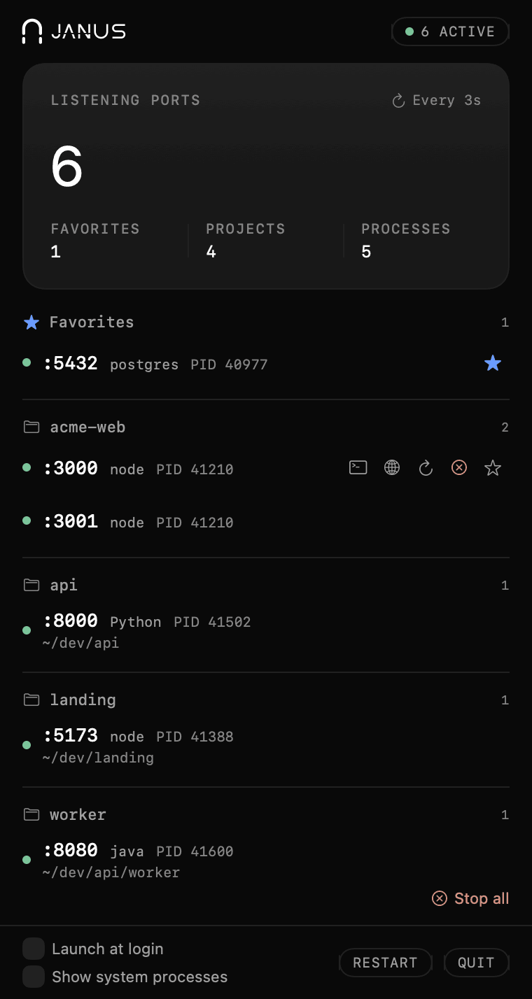

# Janus

[](https://github.com/carloscostadev/janus/releases/latest)
[](https://github.com/carloscostadev/janus/releases)
[](LICENSE)


A lightweight macOS menu bar app that monitors all active localhost ports. See what's running, kill what you don't need - one click away.

[Website](https://janus.carloscostadev.pt) | [Download](https://github.com/carloscostadev/janus/releases/latest)

<p align="center"></p>

> Janus is the Roman god of doorways, gates, and transitions - fitting for an app that watches every port open on your machine.
> Previously released as **LocalPorts**; renamed in v1.0.0 (favorites are migrated automatically on first launch).

## Features

- **Real-time port scanning** - auto-refreshes every 3s, no config needed
- **Project detection** - groups ports by project root (finds `.git`, `package.json`, `Gemfile`, `composer.json`, `go.mod`)
- **Favorites** - pin frequently used ports to the top, persisted across restarts
- **Process management** - stop, restart, or open any port in the browser with one click ("Stop all" asks for confirmation; only your own processes can be signalled, and a PID reused since the last scan is left alone)
- **Visible results** - every action ends in a short status line ("Stopped, port free", "Restarted (PID …)", "Stopped, but PID … listens on it now", "Not stopped: process changed or not yours"); if a scan fails, a notice says the list may be out of date
- **Open in terminal** - jump straight to the project directory in Warp or Terminal
- **Launch at login** - starts automatically with macOS
- **Noise filter** - hides system processes (ControlCenter, rapportd, Spotify, Cursor, AnyDesk, GitHub Desktop, Tailscale, etc.); turn on **Show system processes** in the popover footer to list them too
- **Lightweight** - one `lsof` call per scan, working directories read natively; under 2% of one CPU core on average while idle
- **English and Portuguese (pt-PT)** - follows the macOS language

## Install

Download the latest `.zip` from [Releases](https://github.com/carloscostadev/janus/releases/latest), unzip, and drag `Janus.app` to `/Applications`.

Janus is open source and not notarized by Apple, so macOS asks for confirmation on first launch:

- **macOS 15 or later:** try to open Janus, then go to **System Settings > Privacy & Security** and click **Open Anyway**.
- **macOS 14:** right-click `Janus.app` and choose **Open**.
- **Terminal (any version):** `xattr -dr com.apple.quarantine /Applications/Janus.app`

## Build from Source

```bash
git clone https://github.com/carloscostadev/janus.git
cd janus
./scripts/build.sh
```

## How Stop and Restart work

- **Stop** sends SIGTERM to the process (and to its process group when that is safe, so `npm` doesn't respawn `node`; never a group led by an app such as your editor), waits up to 3 s, then sends SIGKILL if the same process is still alive. It then checks who listens on the port.
- **Restart** stops the process the same way (2 s grace), waits 1 s for the port to be released, and runs the same command again: same arguments, same folder, same environment variables (e.g. `PORT`), in the background. It reports success once something listens on the port again (up to 15 s).
- **Not reproduced on restart:** the terminal (TTY) and its output, which goes to `/dev/null`; and the parent process. When `npm run dev` or a wrapper script started the server, Restart relaunches the server itself (e.g. `node server.js`), not `npm` or the script. Processes of other users and system processes are never signalled.

Tested with real servers (`JANUS_RESTART_E2E=1 swift test --filter RestartE2ETests`): `python3 -m http.server`, `node server.js` reading `PORT`, `npm run dev`, and a shell script whose child holds the port all restart and listen again under a new PID.

## Development

```bash
# Open in Xcode (with SwiftUI previews)
open Package.swift

# Run the tests
swift test

# Popover snapshots (light and dark) and real restarts of local dev servers
JANUS_SNAPSHOT_DIR=/tmp/janus-snapshots swift test --filter SnapshotTests
JANUS_RESTART_E2E=1 swift test --filter RestartE2ETests

# Or build, install to /Applications and run from terminal
./scripts/dev.sh
```

## Requirements

- macOS 14.0 (Sonoma) or later
- Apple Silicon or Intel
- Xcode 16+ / Swift 6 toolchain (for development only; tests use Swift Testing)

## License

[MIT](LICENSE)
